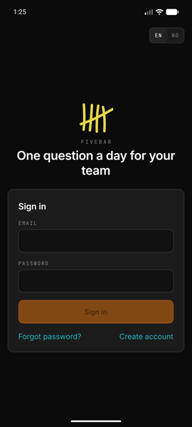
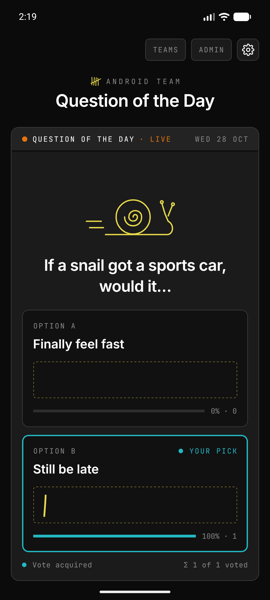
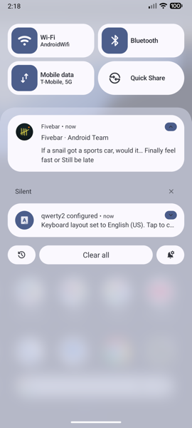

# Fivebar

**One question a day for your team.**

Every day your team gets a new question, from "Would you rather…" to the truly absurd. Everyone votes, the results show up as hand-drawn tally marks, and a notification tells you when the next one arrives.

  
  &nbsp;
  
  &nbsp;
  

- **Website:** [fivebar.selvaag.org](https://fivebar.selvaag.org). Works in any browser, with the same account as the app.
- **Android:** download the APK below.
- **iPhone:** coming to the App Store.

## Install on Android

1. On your Android phone, open the [latest release](../../releases/latest) and download **`fivebar.apk`**.
2. Open the downloaded file. If Android asks, allow installing apps from your browser.
3. Open Fivebar, sign in or create an account, and allow notifications to get the daily question.

Join a team with the invite link someone sends you: paste it under **Join a team** in the app, or open it in the browser.

## What you can do

- Create teams and invite people with a link
- Vote on today's question and see how the team voted
- Browse earlier questions
- Get today's question as a push notification and/or by email, per team
- Admins plan the week, swap suggestions and write their own questions, in English and Norwegian

## Privacy and support

- [Privacy policy](https://fivebar.selvaag.org/privacy)
- [Support](https://fivebar.selvaag.org/support) · [support@selvaag.org](mailto:support@selvaag.org)

You can delete your account at any time in the app: **Settings → Delete account**.

---

## Norsk

**Fivebar – ett spørsmål om dagen til teamet ditt.**

Hver dag får teamet et nytt spørsmål, fra «Vil du heller…» til det helt absurde. Alle stemmer, resultatet vises som håndtegnede streker, og du får varsel når neste spørsmål kommer.

**Installere på Android:**

1. Åpne [siste versjon](../../releases/latest) på Android-telefonen og last ned **`fivebar.apk`**.
2. Åpne filen. Hvis Android spør, tillat installasjon fra nettleseren.
3. Åpne Fivebar, logg inn eller opprett konto, og tillat varsler for å få dagens spørsmål.

Nettsiden finner du på [fivebar.selvaag.org](https://fivebar.selvaag.org), med samme konto som i appen. Les mer om [personvern](https://fivebar.selvaag.org/privacy), eller få [hjelp](https://fivebar.selvaag.org/support).

---

© 2026 Audun Grimstad Selvåg
